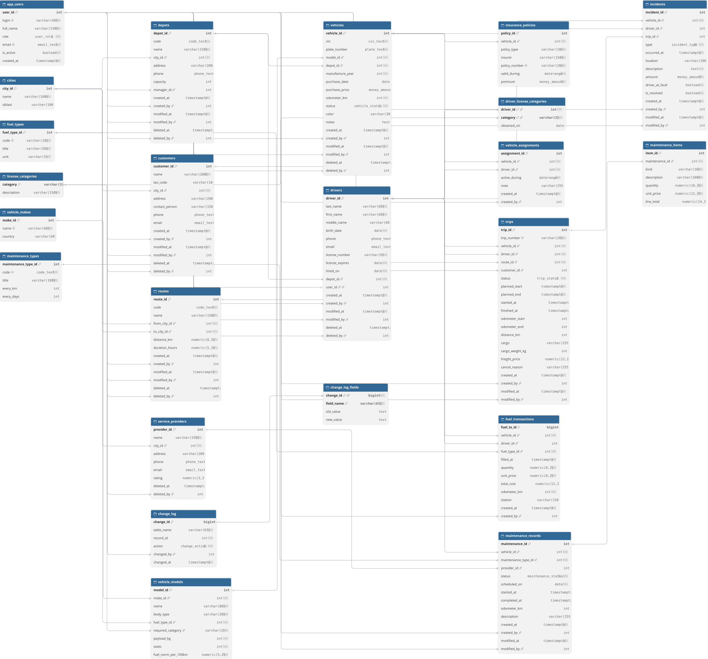

# Система управління автопарком



## Мета

База даних для транспортної компанії з кількома автобазами, власним парком вантажівок і фургонів та штатом водіїв, яка возить вантажі на замовлення клієнтів. Вона дає змогу в одному місці:

- вести облік авто, водіїв, автобаз, замовників, маршрутів і СТО;
- закріплювати водіїв за авто й планувати рейси від заявки до повернення;
- фіксувати пробіг і заправки, порівнювати фактичну витрату пального з нормою;
- бачити, кому з авто час на техобслуговування, і проводити ТО з обліком робіт і запчастин;
- стежити за страховками й посвідченнями, у яких спливає термін;
- реєструвати ДТП, штрафи й поломки і рахувати повну вартість кожного авто;
- зберігати історію змін по полях і не втрачати записи завдяки архівації (soft delete).

## Технології

- PostgreSQL 16
- `pg_trgm`, `btree_gist`
- Python 3.9+, `psycopg2`
- Repository + Unit of Work

## Таблиці та зв'язки

Архівуються замість видалення (`deleted_at`, `deleted_by`): `depots`, `vehicles`, `drivers`, `customers`, `routes`, `service_providers`.

Поля `created_at`/`created_by` і `modified_at`/`modified_by` мають `depots`, `vehicles`, `drivers`, `customers`, `routes`, `trips`, `maintenance_records`, `incidents`. Зміни цих таблиць потрапляють у журнал.

Усі поля `*_by` посилаються на `app_users`.

### Довідники

| Таблиця | Призначення | Зв'язки |
|---|---|---|
| `app_users` | користувачі системи з роллю (адміністратор, диспетчер, механік, керівник автопарку) | 1 → N `depots` (керівник); 1 → 1 `drivers` (обліковий запис водія) |
| `cities` | міста з областю | 1 → N `depots`, `customers`, `service_providers`; 1 → N `routes` (звідки й куди) |
| `fuel_types` | види пального та одиниця виміру | 1 → N `vehicle_models`, `fuel_transactions` |
| `license_categories` | категорії посвідчення водія | 1 → N `vehicle_models`; N ↔ M `drivers` через `driver_license_categories` |
| `vehicle_makes` | марки авто | 1 → N `vehicle_models` |
| `vehicle_models` | моделі: тип кузова, пальне, потрібна категорія, вантажопідйомність, норма витрати | N → 1 `vehicle_makes`, `fuel_types`, `license_categories`; 1 → N `vehicles` |
| `maintenance_types` | види ТО з інтервалом у км та/або днях; позаплановий ремонт без інтервалу | 1 → N `maintenance_records` |

### Автопарк

| Таблиця | Призначення | Зв'язки |
|---|---|---|
| `depots` | автобази | N → 1 `cities`, `app_users`; 1 → N `vehicles`, `drivers` |
| `vehicles` | транспортні засоби: VIN, номер, рік, пробіг, статус | N → 1 `vehicle_models`, `depots`; 1 → N `trips`, `fuel_transactions`, `maintenance_records`, `insurance_policies`, `incidents`, `vehicle_assignments` |
| `insurance_policies` | поліси ОСЦПВ і КАСКО з періодом дії | N → 1 `vehicles` |

### Водії

| Таблиця | Призначення | Зв'язки |
|---|---|---|
| `drivers` | водії з посвідченням і терміном його дії | N → 1 `depots`; 1 → 1 `app_users`; 1 → N `trips`, `vehicle_assignments` |
| `driver_license_categories` | категорії конкретного водія | N → 1 `drivers`, N → 1 `license_categories` (ключ - пара водій + категорія) |
| `vehicle_assignments` | закріплення водія за авто на період | N → 1 `vehicles`, N → 1 `drivers` |

### Перевезення

| Таблиця | Призначення | Зв'язки |
|---|---|---|
| `customers` | замовники перевезень | N → 1 `cities`; 1 → N `trips` |
| `routes` | маршрути з відстанню й тривалістю | N → 1 `cities` (звідки), N → 1 `cities` (куди); 1 → N `trips` |
| `trips` | рейси: план і факт, одометр, вантаж, вартість | N → 1 `vehicles`, `drivers`, `routes`, `customers`; 1 → N `incidents` |
| `fuel_transactions` | заправки з обсягом, ціною й пробігом | N → 1 `vehicles`, `drivers`, `fuel_types` |

### Обслуговування

| Таблиця | Призначення | Зв'язки |
|---|---|---|
| `service_providers` | СТО-партнери | N → 1 `cities`; 1 → N `maintenance_records` |
| `maintenance_records` | ТО і ремонти зі статусом, датами й пробігом | N → 1 `vehicles`, `maintenance_types`, `service_providers`; 1 → N `maintenance_items` |
| `maintenance_items` | роботи й запчастини в межах ТО | N → 1 `maintenance_records` (видаляються разом з ним) |
| `incidents` | ДТП, штрафи, поломки й пошкодження із сумою | N → 1 `vehicles`, `drivers`, `trips` |

### Історія змін

| Таблиця | Призначення | Зв'язки |
|---|---|---|
| `change_log` | хто, коли і що зробив із записом: створив, змінив, архівував, відновив | N → 1 `app_users`; на інші таблиці посилається назвою та id запису |
| `change_log_fields` | старе й нове значення кожного зміненого поля | N → 1 `change_log` (видаляються разом з ним) |

## Вимоги до системи

### Користувачі та історія змін
- Кожен користувач має одну роль. На початку транзакції застосунок відкриває сесію процедурою `sp_session_begin`, а тригери самі записують, хто створив і змінив запис.
- Застосунок підключається окремою роллю `fleet_app`, яка має право лише читати view і викликати процедури. Писати в таблиці напряму вона не може, тож усі зміни гарантовано проходять через процедури.
- Кожна зміна авто, водіїв, депо, замовників, маршрутів, рейсів, ТО та інцидентів потрапляє в журнал разом зі старими й новими значеннями полів.
- Авто, водії, депо, замовники, маршрути й СТО не видаляються фізично: їх архівують і за потреби відновлюють. Архівувати не можна, поки на записі тримаються незавершені рейси, ТО, авто чи водії.

### Авто
- VIN має 17 символів і правильну контрольну цифру (ISO 3779), номер записується в українському форматі `AA1234BB`. VIN і номер унікальні серед неархівних авто.
- Пробіг ніколи не зменшується й оновлюється автоматично після завершення рейсу чи заправки.
- Авто не можна архівувати з незавершеними рейсами або під час ТО. Архівоване авто відновлюється, якщо його VIN і номер ніхто не зайняв.
- Поліси одного типу на одне авто не перетинаються в часі.

### Водії
- Водій має посвідчення з терміном дії та набір категорій; на момент прийому йому має бути 18+.
- За авто закріплюють лише водія з потрібною для моделі категорією і лише за авто, яке не списане. В один день авто має не більше одного водія, і водій - не більше одного авто.
- Звільнити водія з незавершеними рейсами не можна; при звільненні його закріплення закриваються.

### Рейси та пальне
- Рейс проходить статуси: заплановано → у дорозі → завершено, або скасовано до виїзду із зазначенням причини.
- Рейси одного авто чи одного водія не перетинаються в часі, а вантаж не важчий за вантажопідйомність моделі.
- Водій рейсу має потрібну категорію й посвідчення, чинне до кінця рейсу. Якщо водія не вказано, береться закріплений за авто.
- Виїхати можна лише на авто, яке не на ТО. Витрата пального рахується як заправлений обсяг на пробіг рейсів і порівнюється з нормою моделі.

### Техобслуговування та інциденти
- Для кожного авто й виду ТО система рахує, скільки км і днів лишилось до наступного обслуговування.
- ТО проходить статуси: заплановано → у роботі → завершено або скасовано. Поки ТО в роботі, авто має статус «на ТО».
- Рядки робіт і запчастин змінюються лише до закриття ТО.
- Інцидент прив'язується до авто, водія й рейсу. Серйозне ДТП або поломка знімає авто з лінії й автоматично створює заявку на позаплановий ремонт; після ремонту авто повертається на лінію.

## Запуск

Потрібен PostgreSQL 15 або новіший і Python 3.9+.

```bash
createdb fleet_db
cd sql
psql -d fleet_db -f 00_installation.sql
cd ..
pip install -r requirements.txt
FLEET_DSN="dbname=fleet_db user=fleet_app password=fleet_app host=localhost" python -m app.demo
```

Застосунок підключається роллю `fleet_app`, яку створює `01_schema.sql`.

Демо можна запускати повторно: щоразу воно реєструє нові авто й водія з унікальними VIN, номерами й посвідченнями. Щоб повернути базу до початкових даних, достатньо ще раз виконати `00_installation.sql`.

Кожен SQL-запит застосунку видно, якщо додати `SQL_LOG_LEVEL=DEBUG` перед `python -m app.demo`.

## Структура

| Файл | Вміст |
|---|---|
| `sql/00_installation.sql` | встановлення всіх файлів по черзі |
| `sql/01_schema.sql` | типи, домени, таблиці й обмеження |
| `sql/02_functions.sql` | користувацькі функції та перевірки `require_*` |
| `sql/03_triggers.sql` | тригери (історія змін, архівація, пробіг, бізнес-правила) |
| `sql/04_views.sql` | розрізи даних |
| `sql/05_procedures.sql` | збережені процедури |
| `sql/06_indexes.sql` | індекси |
| `sql/07_seed.sql` | тестові дані |
| `app/models.py` | dataclass-моделі рядків view, вхідні дані процедур і enum-и статусів |
| `app/repositories.py` | репозиторії: читання з view, зміни через `CALL fleet.sp_*` |
| `app/unit_of_work.py` | Unit of Work: одне з'єднання й одна транзакція на всі репозиторії, commit, rollback, savepoint |
| `app/demo.py` | демо-сценарії, запуск `python -m app.demo` |
| `diagram/` | схема в DBML для dbdiagram.io |

`UnitOfWork` відкривається через `with`: на вході прив'язує користувача процедурою `sp_session_begin`, а все, що не зафіксовано через `commit()`, відкочується на виході. Після `commit()` чи `rollback()` користувач прив'язується заново, тож у тому самому `with` можна продовжувати роботу в новій транзакції.
